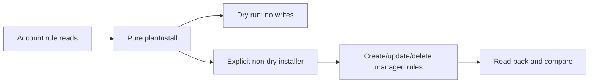

# Installer side-effect boundary (#91)

Design/behavior note before correcting the README status. This PR changes no
runtime code and invokes no installer, collector or SmartThings account action.

Current code distinguishes a pure planner (`src/install.ts`) from the executable
adapter (`scripts/install.ts`). The adapter computes a plan from live account
reads; its dry-run branch does not write, while non-dry application can create,
update and delete managed rules. A plan is not evidence it was applied.

README must not state 'nothing writes yet'. It should state implemented planning
and installer behavior, link the dry-run-first workflow guide, and retain the
known dated-rule pause. Weekly rules remain opt-in; PRUNE and duplicate-managed
rule deletion should not be described as read-only. Do not broaden the supported
rule scope or promise that all dated rules are untouched under every flag.

Next focused implementation/docs PR: correct the status paragraph and add an
offline consistency regression that asserts the dry-run/non-dry boundary and
source create/update/delete calls. Keep tests local, synthetic and network-free.
This note does not authorize a live installer or imply one was run in this audit.
